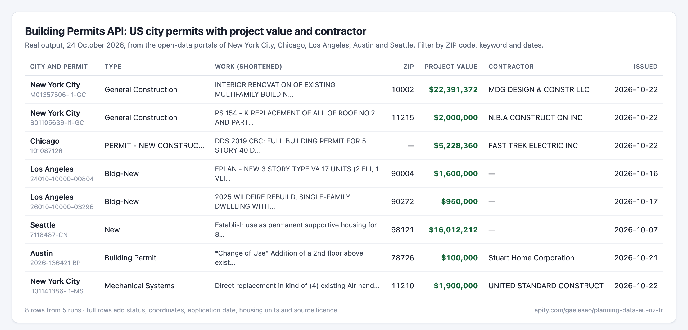
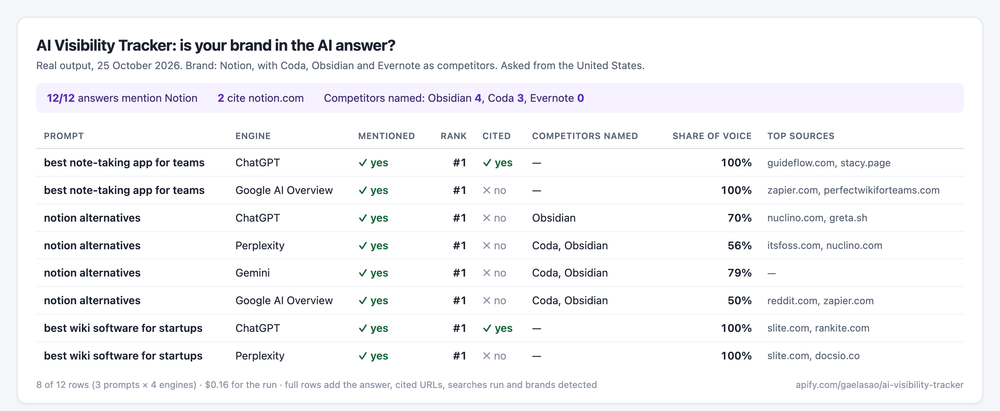

# Keyword research, building permits and AI visibility data for AI agents (MCP)

Three pay-per-use data tools that any MCP client (Claude, Cursor, VS Code, Codex…) can call. They run on [Apify](https://apify.com) and are served through the official [Apify MCP server](https://docs.apify.com/platform/integrations/mcp): there is nothing to install or host.

## Keyword Research API: search volume, CPC, difficulty, intent

Keyword search volume and the rest of Google's keyword data in bulk, in every country. A Google Keyword Planner alternative for agents, with no Google Ads account needed:

- **Metrics** for up to 10,000 keywords per run: search volume, 12-month history, CPC, competition, top-of-page bids, keyword difficulty, search intent, trend, **AI search volume** (how often the keyword comes up in AI assistants) and **SERP features** (AI Overview, featured snippet, People Also Ask...), plus **Bing search volume** on runs of 300+ keywords.
- **Keyword ideas** from 1 to 20 seed keywords: broad ideas, long-tail suggestions that contain the seed, or Google's related searches.
- **Competitor keywords**: up to 10 websites per run, with position, ranking page and estimated traffic; filter positions 4 to 20 for striking distance keywords.


Price: **$2 per 1,000 keywords with data**, plus $0.01 per run that returns data. Keywords without data are free. Lower prices on higher Apify plans.

- MCP URL: `https://mcp.apify.com/?tools=gaelasao/keyword-research-api`
- Store page: https://apify.com/gaelasao/keyword-research-api
- How it was built: [Keyword research for AI agents: search volume, CPC and difficulty over MCP](https://dev.to/gal_gerard_5a39555b810e9/keyword-research-for-ai-agents-search-volume-cpc-and-difficulty-over-mcp-bdf) (DEV)
- Case studies (DEV): [Striking distance keywords: what dev.to ranks 11 to 20 for on Google](https://dev.to/gal_gerard_5a39555b810e9/striking-distance-keywords-what-devto-ranks-11-to-20-for-on-google-m8p) and [AI search volume vs Google search volume: what 600 real keywords show](https://dev.to/gal_gerard_5a39555b810e9/ai-search-volume-vs-google-search-volume-what-600-real-keywords-show-3om0)
- Compared with Keyword Planner (DEV): [A Google Keyword Planner alternative API: search volume numbers without a Google Ads account](https://dev.to/gal_gerard_5a39555b810e9/a-google-keyword-planner-alternative-api-search-volume-numbers-without-a-google-ads-account-5h79)

Try asking your agent:
- *"Get search volume, CPC and difficulty for these 50 keywords in Germany, sorted by volume."*
- *"Which keywords bring competitor.com the most traffic in the UK? Show the top 30 with their ranking pages."*
- *"Find 200 long-tail ideas around 'standing desk' with at least 100 searches a month."*

## Building Permits API (12 US cities and counties, France, NSW Australia, Far North NZ)

Official building permits and planning applications, normalised into one schema, with source links and licences:
- **United States**: issued permits from 12 city and county open-data portals (New York City, Los Angeles, Chicago, Dallas, Seattle, Austin, Orlando, New Orleans, Cincinnati, Mesa, Baton Rouge, Montgomery County MD), with the declared project value and, where published, the contractor's business name. Filter by ZIP code and keywords.
- **France**: SDES Sitadel housing, non-residential, development and demolition permits, including the applicant company and its SIREN when it is a legal entity.
- **Australia and New Zealand**: NSW Planning Portal applications and Far North District building applications.




Price: $5 per 1,000 records (lower on higher Apify plans).

- MCP URL: `https://mcp.apify.com/?tools=gaelasao/planning-data-au-nz-fr`
- Store page: https://apify.com/gaelasao/planning-data-au-nz-fr
- One week of real US data (DEV): [Building permits from 12 US cities in one API: a week of real data](https://dev.to/gal_gerard_5a39555b810e9/building-permits-from-12-us-cities-in-one-api-a-week-of-real-data-2pn)

## AI Visibility Tracker: brand mentions in ChatGPT, Perplexity, Gemini and Google AI

Ask the AI engines the questions your customers ask and see whether they mention and cite your brand:
- **Engines**: Google AI Overview, Google AI Mode, ChatGPT (with web search), Gemini and Perplexity, from the country you choose.
- **One row per prompt and engine**: brand mentioned, rank among the brands named, cited as a source, competitors named or cited, share of voice, top source domains, the searches the engine ran, and the answer.
- **A summary by engine and by competitor**, plus the most cited domains: the pages to win a mention on.



Price: **$0.01 per check** (one prompt on one engine; Perplexity counts as 2). Failed checks are free.

- MCP URL: `https://mcp.apify.com/?tools=gaelasao/ai-visibility-tracker`
- Store page: https://apify.com/gaelasao/ai-visibility-tracker

Try asking your agent:
- *"Check whether ChatGPT, Perplexity and Google AI Overviews mention Notion for these 10 prompts in the US, and compare with Coda and Obsidian."*

## n8n templates

Ready-to-import [n8n](https://n8n.io) workflows in [`n8n/`](n8n), built on the official Apify node:
- [`keyword-tracking-google-sheets.json`](n8n/keyword-tracking-google-sheets.json): every Monday, one row per keyword in Google Sheets with search volume, CPC, difficulty, intent, AI search volume and AI Overview.
- [`building-permits-weekly-digest.json`](n8n/building-permits-weekly-digest.json): every Monday, last week's building permits in your US ZIP codes, sent by Gmail and Slack.

In n8n, import the file into a new workflow, then add your Apify, Google, Gmail or Slack credentials. The sticky notes in each workflow explain the setup and the costs.

## Connect

You need an Apify account; runs are billed to it. Clients that support OAuth sign you in on first use. Otherwise, pass your [Apify API token](https://console.apify.com/settings/integrations).

**Claude Code**

```bash
claude mcp add --transport http apify "https://mcp.apify.com/?tools=gaelasao/keyword-research-api" --header "Authorization: Bearer $APIFY_TOKEN"
```

**Claude Desktop, Cursor or VS Code** (JSON config)

```json
{
  "mcpServers": {
    "apify-keyword-research": {
      "url": "https://mcp.apify.com/?tools=gaelasao/keyword-research-api",
      "headers": { "Authorization": "Bearer YOUR_APIFY_TOKEN" }
    }
  }
}
```

Use several tools at once with `?tools=gaelasao/keyword-research-api,gaelasao/planning-data-au-nz-fr,gaelasao/ai-visibility-tracker`.

## Support

Open an issue on the Actor's **Issues** tab on Apify, with the run ID and your input. Never post your API token.
