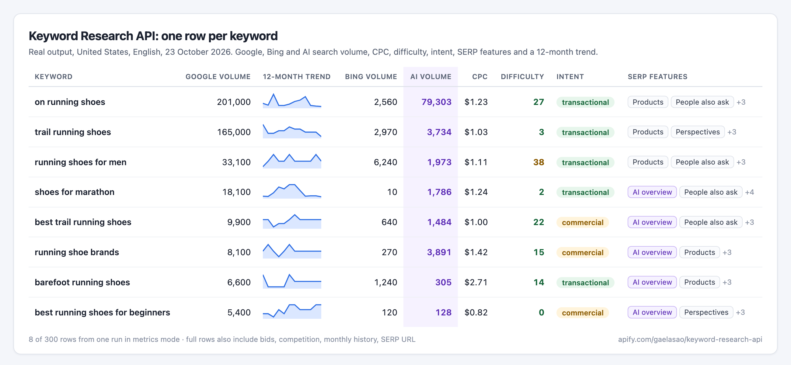
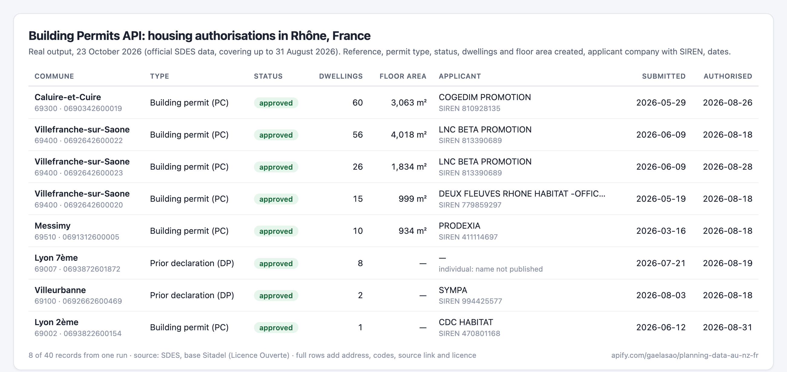

# Keyword research and building permit data for AI agents (MCP)

Two pay-per-use data tools that any MCP client (Claude, Cursor, VS Code, Codex…) can call. They run on [Apify](https://apify.com) and are served through the official [Apify MCP server](https://docs.apify.com/platform/integrations/mcp): there is nothing to install or host.

## Keyword Research API: search volume, CPC, difficulty, intent

Keyword search volume and the rest of Google's keyword data in bulk, in every country. A Google Keyword Planner alternative for agents, with no Google Ads account needed:

- **Metrics** for up to 10,000 keywords per run: search volume, 12-month history, CPC, competition, top-of-page bids, keyword difficulty, search intent, trend, **AI search volume** (how often the keyword comes up in AI assistants) and **SERP features** (AI Overview, featured snippet, People Also Ask...), plus **Bing search volume** on runs of 300+ keywords.
- **Keyword ideas** from 1 to 20 seed keywords: broad ideas, long-tail suggestions that contain the seed, or Google's related searches.
- **Competitor keywords**: up to 10 websites per run, with position, ranking page and estimated traffic; filter positions 4 to 20 for striking distance keywords.



Price: **$2 per 1,000 keywords with data**, plus $0.01 per run that returns data. Keywords without data are free. Lower prices on higher Apify plans.

- MCP URL: `https://mcp.apify.com/?tools=gaelasao/keyword-research-api`
- Store page: https://apify.com/gaelasao/keyword-research-api
- How it was built: [Keyword research for AI agents: search volume, CPC and difficulty over MCP](https://dev.to/gal_gerard_5a39555b810e9/keyword-research-for-ai-agents-search-volume-cpc-and-difficulty-over-mcp-bdf) (DEV)

Try asking your agent:
- *"Get search volume, CPC and difficulty for these 50 keywords in Germany, sorted by volume."*
- *"Which keywords bring competitor.com the most traffic in the UK? Show the top 30 with their ranking pages."*
- *"Find 200 long-tail ideas around 'standing desk' with at least 100 searches a month."*

## Building Permits API (France, NSW Australia, Far North New Zealand)

Official building permits and planning applications, normalised into one schema, with source links and licences: France (SDES Sitadel: housing, non-residential, development and demolition permits, including the applicant company and its SIREN when it is a legal entity), NSW Planning Portal applications, and Far North District building applications.



Price: $5 per 1,000 records (lower on higher Apify plans).

- MCP URL: `https://mcp.apify.com/?tools=gaelasao/planning-data-au-nz-fr`
- Store page: https://apify.com/gaelasao/planning-data-au-nz-fr

## Connect

You need an Apify account; runs are billed to it. Clients that support OAuth sign you in on first use. Otherwise, pass your [Apify API token](https://console.apify.com/settings/integrations).

**Claude Code**

```bash
claude mcp add --transport http apify "https://mcp.apify.com/?tools=gaelasao/keyword-research-api" --header "Authorization: Bearer $APIFY_TOKEN"
```

**Claude Desktop, Cursor or VS Code** (JSON config)

```json
{
  "mcpServers": {
    "apify-keyword-research": {
      "url": "https://mcp.apify.com/?tools=gaelasao/keyword-research-api",
      "headers": { "Authorization": "Bearer YOUR_APIFY_TOKEN" }
    }
  }
}
```

Use both tools at once with `?tools=gaelasao/keyword-research-api,gaelasao/planning-data-au-nz-fr`.

## Support

Open an issue on the Actor's **Issues** tab on Apify, with the run ID and your input. Never post your API token.
